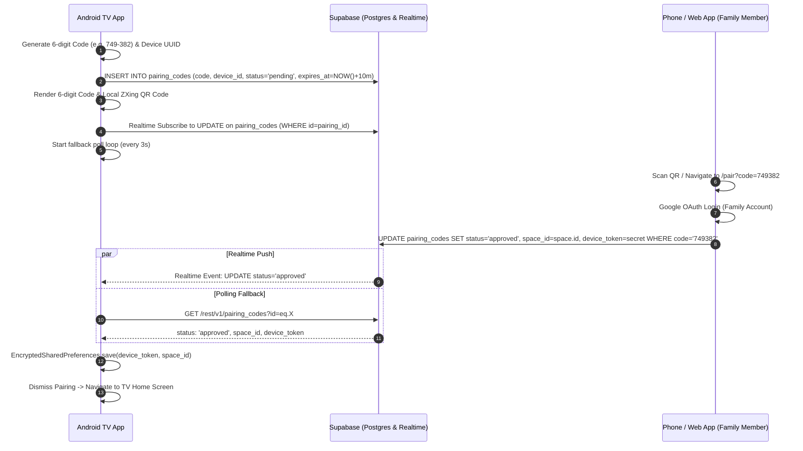

# Android TV Module: Technical Architecture Specification

**Target Platform:** Android TV (minSdk 28 / Android 9.0 Pie, targetSdk 34 / Android 14)  
**Primary Language & Framework:** Kotlin 2.0+ with Jetpack Compose for TV (Material 3)  
**Backend:** Supabase (Auth, Postgres, Realtime, Storage, Edge Functions)  
**Architecture Pattern:** Unidirectional Data Flow (UDF) / MVVM + Clean Architecture with Coroutines & StateFlow  

---

## 1. Technology Stack & Library Version Recommendations

### 1.1 Core Dependency Matrix

| Layer / Concern | Library & Artifact | Recommended Version | Justification & Rationale |
| :--- | :--- | :--- | :--- |
| **TV UI Toolkit** | `androidx.tv:tv-foundation`<br>`androidx.tv:tv-material` | `1.0.0`<br>`1.1.0` | Official stable TV Compose libraries. Provides TV-specific focus management, `TvLazyRow`, `TvLazyColumn`, `Surface`, and `Card` components with 10-foot focus rings and scale transformations. |
| **Compose Base** | `androidx.compose:compose-bom`<br>`androidx.activity:activity-compose`<br>`androidx.lifecycle:lifecycle-runtime-compose` | `2024.06.00`<br>`1.9.0`<br>`2.8.0` | Stable Compose foundation with `collectAsStateWithLifecycle()` to prevent background rendering and CPU leaks on low-power TV processors. |
| **Local Database** | `androidx.room:room-runtime`<br>`androidx.room:room-ktx`<br>`androidx.room:room-compiler` | `2.6.1` (KSP) | Stable, battle-tested SQLite abstraction. Includes first-class support for Coroutines Flow, transaction management, and Full-Text Search (FTS4). |
| **Image Loading** | `io.coil-kt:coil`<br>`io.coil-kt:coil-compose` | `2.6.0` | Lightweight, coroutine-native image loader. Easily tuned for memory-constrained TV devices (RGB_565 configuration, strict 15% RAM cache limit). |
| **PDF Rendering** | `android.graphics.pdf.PdfRenderer` (Native Android SDK) | Built-in (API 28+) | Zero third-party binary weight (NDK/C++ size overhead). Robust on Android 9+ when wrapped in a synchronized single-threaded thread pool with strict 3-page bitmap pooling. |
| **Concurrency** | `org.jetbrains.kotlinx:kotlinx-coroutines-android` | `1.8.1` | Efficient background dispatching (`Dispatchers.IO` for file I/O and PDF decoding, `Dispatchers.Main.immediate` for UI/focus updates). |
| **Backend & Sync** | `io.github.jan-tennert.supabase:postgrest-kt`<br>`io.github.jan-tennert.supabase:realtime-kt`<br>`io.github.jan-tennert.supabase:storage-kt`<br>`io.github.jan-tennert.supabase:gotrue-kt` | `2.5.4` | Modern multiplatform Kotlin SDK for Supabase. Supports WebSocket Realtime subscriptions and typed PostgREST queries over Ktor HTTP engine. |
| **HTTP Engine** | `io.ktor:ktor-client-okhttp` | `2.3.12` | Battle-tested OkHttp engine underneath Supabase SDK for HTTP connection pooling and WebSocket stability on API 28. |
| **Secure Storage** | `androidx.security:security-crypto` | `1.1.0-alpha06` | Hardware-backed KeyStore encryption (`MasterKey` with AES256-GCM and AES256-SIV) for TV device credentials, with fallback for buggy Android 9 TV OEM chipsets. |
| **QR Code Gen** | `com.google.zxing:core` | `3.5.3` | Generates pairing QR code bitmaps locally on TV without external network calls or webview overhead. |

---

### 1.2 Gradle Configuration (`tv/build.gradle.kts`)

```kotlin
plugins {
    alias(libs.plugins.android.application)
    alias(libs.plugins.kotlin.android)
    alias(libs.plugins.kotlin.compose)
    alias(libs.plugins.ksp)
}

android {
    namespace = "com.familylibrary.tv"
    compileSdk = 34

    defaultConfig {
        applicationId = "com.familylibrary.tv"
        minSdk = 28
        targetSdk = 34
        versionCode = 1
        versionName = "1.0.0"

        testInstrumentationRunner = "androidx.test.runner.AndroidJUnitRunner"
        vectorDrawables {
            useSupportLibrary = true
        }
    }

    buildTypes {
        release {
            isMinifyEnabled = true
            isShrinkResources = true
            proguardFiles(
                getDefaultProguardFile("proguard-android-optimize.txt"),
                "proguard-rules.pro"
            )
            signingConfig = signingConfigs.getByName("debug") // Replace with release keystore
        }
    }

    compileOptions {
        sourceCompatibility = JavaVersion.VERSION_17
        targetCompatibility = JavaVersion.VERSION_17
    }

    kotlinOptions {
        jvmTarget = "17"
        freeCompilerArgs += listOf(
            "-opt-in=androidx.tv.material3.ExperimentalTvMaterial3Api",
            "-opt-in=kotlinx.coroutines.ExperimentalCoroutinesApi"
        )
    }

    buildFeatures {
        compose = true
    }
}

dependencies {
    // Jetpack Compose for TV
    implementation("androidx.tv:tv-foundation:1.0.0")
    implementation("androidx.tv:tv-material:1.1.0")

    // Compose Foundation & Lifecycle
    val composeBom = platform("androidx.compose:compose-bom:2024.06.00")
    implementation(composeBom)
    implementation("androidx.compose.ui:ui")
    implementation("androidx.compose.ui:ui-graphics")
    implementation("androidx.compose.ui:ui-tooling-preview")
    implementation("androidx.activity:activity-compose:1.9.0")
    implementation("androidx.lifecycle:lifecycle-runtime-compose:2.8.0")
    implementation("androidx.lifecycle:lifecycle-viewmodel-compose:2.8.0")
    implementation("androidx.navigation:navigation-compose:2.7.7")

    // Room Database + FTS4
    val roomVersion = "2.6.1"
    implementation("androidx.room:room-runtime:$roomVersion")
    implementation("androidx.room:room-ktx:$roomVersion")
    ksp("androidx.room:room-compiler:$roomVersion")

    // Coil Image Loading
    implementation("io.coil-kt:coil-compose:2.6.0")

    // Supabase Kotlin SDK
    val supabaseVersion = "2.5.4"
    implementation("io.github.jan-tennert.supabase:postgrest-kt:$supabaseVersion")
    implementation("io.github.jan-tennert.supabase:realtime-kt:$supabaseVersion")
    implementation("io.github.jan-tennert.supabase:storage-kt:$supabaseVersion")
    implementation("io.github.jan-tennert.supabase:gotrue-kt:$supabaseVersion")
    implementation("io.ktor:ktor-client-okhttp:2.3.12")

    // Security & Crypto
    implementation("androidx.security:security-crypto:1.1.0-alpha06")

    // QR Code Generation
    implementation("com.google.zxing:core:3.5.3")

    // Coroutines
    implementation("org.jetbrains.kotlinx:kotlinx-coroutines-android:1.8.1")
}
```

---

### 1.3 Room Database with Full-Text Search (FTS4)

#### Why FTS4 over FTS5 on Android 9 (API 28):
SQLite on Android 9 is version 3.22. While FTS5 was technically introduced in SQLite 3.9, several Android TV OEM firmware builds (especially budget Amlogic/Rockchip/MStar boards) either compiled SQLite without `SQLITE_ENABLE_FTS5` or suffer from driver incompatibilities. **FTS4 is guaranteed to be available across 100% of Android devices from API 11 through 34**, making it the only resilient choice for a minSdk 28 Android TV app.

#### Room Schema Definition:

```kotlin
package com.familylibrary.tv.data.local

import androidx.room.ColumnInfo
import androidx.room.Dao
import androidx.room.Database
import androidx.room.Entity
import androidx.room.Fts4
import androidx.room.Insert
import androidx.room.OnConflictStrategy
import androidx.room.PrimaryKey
import androidx.room.Query
import androidx.room.RoomDatabase
import androidx.room.Transaction
import kotlinx.coroutines.flow.Flow

// 1. Standard Content Table
@Entity(tableName = "files")
data class FileEntity(
    @PrimaryKey
    val id: String,
    val name: String,
    @ColumnInfo(name = "mime_type")
    val mimeType: String,
    @ColumnInfo(name = "file_size")
    val fileSize: Long,
    @ColumnInfo(name = "storage_path")
    val storagePath: String,
    @ColumnInfo(name = "pdf_path")
    val pdfPath: String?,
    @ColumnInfo(name = "text_path")
    val textPath: String?,
    @ColumnInfo(name = "extracted_text")
    val extractedText: String?, // Pre-extracted text for FTS search & TTS
    @ColumnInfo(name = "folder_id")
    val folderId: String?,
    @ColumnInfo(name = "is_favorite")
    val isFavorite: Boolean = false,
    @ColumnInfo(name = "last_opened_at")
    val lastOpenedAt: Long? = null,
    @ColumnInfo(name = "last_opened_page")
    val lastOpenedPage: Int = 0,
    @ColumnInfo(name = "created_at")
    val createdAt: Long,
    @ColumnInfo(name = "deleted_at")
    val deletedAt: Long? = null
)

// 2. FTS4 Virtual Table for Instant Search
@Entity(tableName = "files_fts")
@Fts4(contentEntity = FileEntity::class)
data class FileFtsEntity(
    @PrimaryKey
    @ColumnInfo(name = "rowid")
    val rowId: Int,
    val name: String,
    @ColumnInfo(name = "extracted_text")
    val extractedText: String?
)

// 3. DAO with Search & Filter Queries
@Dao
interface FileDao {
    @Query("""
        SELECT files.* FROM files
        JOIN files_fts ON files.id = files_fts.rowid
        WHERE files_fts MATCH :searchQuery AND files.deleted_at IS NULL
        ORDER BY files.last_opened_at DESC
    """)
    fun searchFiles(searchQuery: String): Flow<List<FileEntity>>

    @Query("SELECT * FROM files WHERE deleted_at IS NULL ORDER BY created_at DESC")
    fun getAllActiveFiles(): Flow<List<FileEntity>>

    @Query("SELECT * FROM files WHERE is_favorite = 1 AND deleted_at IS NULL ORDER BY name ASC")
    fun getFavoriteFiles(): Flow<List<FileEntity>>

    @Query("SELECT * FROM files WHERE last_opened_at IS NOT NULL AND deleted_at IS NULL ORDER BY last_opened_at DESC LIMIT 10")
    fun getContinueReadingFiles(): Flow<List<FileEntity>>

    @Insert(onConflict = OnConflictStrategy.REPLACE)
    suspend fun upsertFiles(files: List<FileEntity>)

    @Query("UPDATE files SET last_opened_at = :timestamp, last_opened_page = :page WHERE id = :fileId")
    suspend fun updateReadingProgress(fileId: String, page: Int, timestamp: Long)

    @Query("UPDATE files SET is_favorite = :isFavorite WHERE id = :fileId")
    suspend fun toggleFavorite(fileId: String, isFavorite: Boolean)
}

@Database(
    entities = [FileEntity::class, FileFtsEntity::class, CachedFileEntity::class],
    version = 1,
    exportSchema = false
)
abstract class AppDatabase : RoomDatabase() {
    abstract fun fileDao(): FileDao
    abstract fun cacheDao(): CacheDao
}
```

---

### 1.4 Coil Image Loading Configuration for Low-Memory TVs

Android TV devices commonly run with an app heap limit of 192 MB (or 128 MB on budget sticks). Setting an unconstrained image loader will lead to rapid `OutOfMemoryError` crashes.

```kotlin
package com.familylibrary.tv.core

import android.content.Context
import android.graphics.Bitmap
import coil.ImageLoader
import coil.disk.DiskCache
import coil.memory.MemoryCache
import coil.request.CachePolicy
import coil.util.DebugLogger

object TvImageLoaderFactory {
    fun create(context: Context): ImageLoader {
        return ImageLoader.Builder(context)
            // Memory Cache: strictly capped at 15% of total available heap
            .memoryCache {
                MemoryCache.Builder(context)
                    .maxSizePercent(0.15)
                    .strongReferencesEnabled(true)
                    .build()
            }
            // Disk Cache: max 100 MB in dedicated cache dir
            .diskCache {
                DiskCache.Builder()
                    .directory(context.cacheDir.resolve("image_cache"))
                    .maxSizeBytes(100L * 1024 * 1024)
                    .build()
            }
            // Optimization for TV: RGB_565 halves bitmap memory footprint compared to ARGB_8888
            .bitmapConfig(Bitmap.Config.RGB_565)
            .allowRgb565(true)
            .networkCachePolicy(CachePolicy.ENABLED)
            .diskCachePolicy(CachePolicy.ENABLED)
            .memoryCachePolicy(CachePolicy.ENABLED)
            .crossfade(true)
            .build()
    }
}
```

---

### 1.5 Android PdfRenderer Engine: Low-Memory & Page Caching (API 28)

#### Critical Android 9 `PdfRenderer` Constraints:
1. **Single-Page Concurrency Limit:** The native `PdfRenderer` class strictly throws an `IllegalStateException` if `openPage(n)` is invoked while any previous `PdfRenderer.Page` instance is still open.
2. **Native Memory Leaks:** Bitmaps generated from `render()` allocate unmanaged native memory. On Android 9, failing to close pages or reuse/recycle bitmaps immediately causes native heap exhaustion.
3. **Low-Memory 3-Page Window:** The renderer maintains an LRU memory pool of exactly 3 decoded page bitmaps: `[Current Page - 1, Current Page, Current Page + 1]`. All other pages are recycled.

```kotlin
package com.familylibrary.tv.viewer.pdf

import android.graphics.Bitmap
import android.graphics.Color
import android.graphics.Matrix
import android.graphics.pdf.PdfRenderer
import android.os.ParcelFileDescriptor
import android.util.LruCache
import kotlinx.coroutines.CoroutineDispatcher
import kotlinx.coroutines.Dispatchers
import kotlinx.coroutines.sync.Mutex
import kotlinx.coroutines.sync.withLock
import kotlinx.coroutines.withContext
import java.io.File

class SafeTvPdfRenderer(
    private val pdfFile: File,
    private val targetWidth: Int = 1920,
    private val targetHeight: Int = 1080,
    private val dispatcher: CoroutineDispatcher = Dispatchers.IO
) : AutoCloseable {

    private val mutex = Mutex()
    private var fileDescriptor: ParcelFileDescriptor? = null
    private var renderer: PdfRenderer? = null

    // Cache exactly 3 pages: Previous, Current, Next (1920x1080 @ RGB_565 ≈ 4.14 MB each -> ~12.5 MB total)
    private val pageBitmapCache = object : LruCache<Int, Bitmap>(3) {
        override fun entryRemoved(evicted: Boolean, key: Int, oldValue: Bitmap, newValue: Bitmap?) {
            if (evicted && oldValue != newValue) {
                oldValue.recycle()
            }
        }
    }

    suspend fun init(): Int = withContext(dispatcher) {
        mutex.withLock {
            val pfd = ParcelFileDescriptor.open(pdfFile, ParcelFileDescriptor.MODE_READ_ONLY)
            fileDescriptor = pfd
            val nativeRenderer = PdfRenderer(pfd)
            renderer = nativeRenderer
            nativeRenderer.pageCount
        }
    }

    suspend fun renderPage(pageIndex: Int): Bitmap? = withContext(dispatcher) {
        // 1. Check memory cache first
        pageBitmapCache.get(pageIndex)?.let { cached ->
            if (!cached.isRecycled) return@withContext cached
        }

        // 2. Synchronously open page, render, and close page
        mutex.withLock {
            val currentRenderer = renderer ?: return@withContext null
            if (pageIndex < 0 || pageIndex >= currentRenderer.pageCount) return@withContext null

            var page: PdfRenderer.Page? = null
            try {
                // Guaranteed only one page open at a time
                page = currentRenderer.openPage(pageIndex)

                // Calculate aspect ratio fit for 10-foot TV display
                val scale = minOf(
                    targetWidth.toFloat() / page.width,
                    targetHeight.toFloat() / page.height
                )
                val renderWidth = (page.width * scale).toInt()
                val renderHeight = (page.height * scale).toInt()

                // Use RGB_565 to save 50% RAM on Android TV
                val bitmap = Bitmap.createBitmap(renderWidth, renderHeight, Bitmap.Config.RGB_565)
                bitmap.eraseColor(Color.WHITE)

                val matrix = Matrix().apply {
                    postScale(scale, scale)
                }

                page.render(bitmap, null, matrix, PdfRenderer.Page.RENDER_MODE_FOR_DISPLAY)

                pageBitmapCache.put(pageIndex, bitmap)
                return@withContext bitmap
            } finally {
                // Must close immediately to allow rendering subsequent or prefetched pages
                page?.close()
            }
        }
    }

    suspend fun prefetch(pageIndex: Int) {
        if (pageIndex in 0 until (renderer?.pageCount ?: 0)) {
            renderPage(pageIndex)
        }
    }

    fun clearCache() {
        pageBitmapCache.evictAll()
    }

    override fun close() {
        clearCache()
        renderer?.close()
        fileDescriptor?.close()
        renderer = null
        fileDescriptor = null
    }
}
```

---

## 2. D-Pad Remote Navigation Model & 10-Foot UI Architecture

### 2.1 10-Foot Design Principles for Android TV

```
+--------------------------------------------------------------------------------+
|  5% Safe Area / Overscan Margin (48dp left/right, 27dp top/bottom on 1080p)   |
|                                                                                |
|  +--------------------------------------------------------------------------+  |
|  | Header / Section Title (32sp SemiBold)                                  |  |
|  |                                                                          |  |
|  | [ Card 1 (Focused) ]     [ Card 2 ]              [ Card 3 ]              |  |
|  |  +-----------------+      +-----------------+     +-----------------+    |  |
|  |  | Scale: 1.06x    |      | Normal (1.0x)   |     | Normal (1.0x)   |    |  |
|  |  | Border: 3dp Cyan|      | Border: None    |     | Border: None    |    |  |
|  |  | Title: 24sp Bold|      | Title: 24sp     |     | Title: 24sp     |    |  |
|  |  +-----------------+      +-----------------+     +-----------------+    |  |
|  +--------------------------------------------------------------------------+  |
|                                                                                |
+--------------------------------------------------------------------------------+
```

1. **5% Overscan Safe Area:** Many TVs clip up to 5% of borders due to legacy analog overscan simulation. All key interactive components and text must live inside `padding(horizontal = 48.dp, vertical = 27.dp)`.
2. **Typography Hierarchy (24sp+ Body):**
   - Display/Large Headers: `44.sp` to `48.sp` (Bold)
   - Category / Section Headers: `32.sp` (SemiBold)
   - Card Titles & Primary Text: `24.sp` (Medium)
   - Metadata / Subtitles: `20.sp` to `22.sp` (Never drop below `18.sp`).
3. **High-Contrast Focus Feedback:**
   - Active focus must be unambiguously visible from 3 meters (10 feet) away.
   - Use triple visual reinforcement: **Scale factor (1.06x)** + **3dp Accent Border (Cyan/White)** + **Elevated Glow Shadow**.

---

### 2.2 Remote D-Pad Navigation & Key Event Architecture

The D-pad remote sends standard Android `KeyEvent` codes. In Jetpack Compose for TV, navigation is achieved using `FocusRequester`, `focusRestorer`, and custom `onPreviewKeyEvent`.

#### Remote Key Mapping Table:

| Remote Button | Android Keycode | In-App Viewer Action | Grid / Row Navigation Action |
| :--- | :--- | :--- | :--- |
| **D-Pad Center / OK** | `KEYCODE_DPAD_CENTER`<br>`KEYCODE_ENTER` | Toggle UI Overlay (Toolbar / Page Scrubber) | Open Selected File / Enter Folder |
| **D-Pad Left** | `KEYCODE_DPAD_LEFT` | Previous Page / Rewind 10s | Move focus left in row |
| **D-Pad Right** | `KEYCODE_DPAD_RIGHT` | Next Page / Fast-Forward 10s | Move focus right in row |
| **D-Pad Up** | `KEYCODE_DPAD_UP` | Zoom in / Scroll viewport up | Move focus to previous row/category |
| **D-Pad Down** | `KEYCODE_DPAD_DOWN` | Zoom out / Scroll viewport down | Move focus to next row/category |
| **Back Button** | `KEYCODE_BACK` | Close Viewer -> Return to Home | Exit search / Return to parent row |
| **Play / Pause** | `KEYCODE_MEDIA_PLAY_PAUSE` | Toggle Read-Aloud (TTS) / Slideshow | No-op (or play preview) |

---

### 2.3 TV-Optimized Focusable Card Component (`TvFileCard.kt`)

```kotlin
package com.familylibrary.tv.ui.components

import androidx.compose.animation.core.animateFloatAsState
import androidx.compose.foundation.BorderStroke
import androidx.compose.foundation.layout.Box
import androidx.compose.foundation.layout.Column
import androidx.compose.foundation.layout.Spacer
import androidx.compose.foundation.layout.fillMaxSize
import androidx.compose.foundation.layout.fillMaxWidth
import androidx.compose.foundation.layout.height
import androidx.compose.foundation.layout.padding
import androidx.compose.foundation.layout.width
import androidx.compose.foundation.shape.RoundedCornerShape
import androidx.compose.runtime.Composable
import androidx.compose.runtime.getValue
import androidx.compose.runtime.mutableStateOf
import androidx.compose.runtime.remember
import androidx.compose.runtime.setValue
import androidx.compose.ui.Alignment
import androidx.compose.ui.Modifier
import androidx.compose.ui.draw.scale
import androidx.compose.ui.focus.onFocusChanged
import androidx.compose.ui.graphics.Color
import androidx.compose.ui.layout.ContentScale
import androidx.compose.ui.platform.LocalContext
import androidx.compose.ui.text.font.FontWeight
import androidx.compose.ui.text.style.TextOverflow
import androidx.compose.ui.unit.dp
import androidx.compose.ui.unit.sp
import androidx.tv.material3.Border
import androidx.tv.material3.Card
import androidx.tv.material3.CardDefaults
import androidx.tv.material3.CardScale
import androidx.tv.material3.ExperimentalTvMaterial3Api
import androidx.tv.material3.Glow
import androidx.tv.material3.MaterialTheme
import androidx.tv.material3.Text
import coil.compose.AsyncImage
import coil.request.ImageRequest
import com.familylibrary.tv.data.local.FileEntity

@OptIn(ExperimentalTvMaterial3Api::class)
@Composable
fun TvFileCard(
    file: FileEntity,
    onClick: () -> Unit,
    modifier: Modifier = Modifier
) {
    Card(
        onClick = onClick,
        modifier = modifier
            .width(240.dp)
            .height(180.dp),
        shape = CardDefaults.shape(shape = RoundedCornerShape(12.dp)),
        scale = CardScale.modify(
            focusedScale = 1.06f,
            pressedScale = 0.98f
        ),
        border = CardDefaults.border(
            focusedBorder = Border(
                border = BorderStroke(3.dp, Color(0xFF00E5FF)), // High-contrast Neon Cyan
                shape = RoundedCornerShape(12.dp)
            )
        ),
        glow = CardDefaults.glow(
            focusedGlow = Glow(
                elevationColor = Color(0x6600E5FF),
                elevation = 16.dp
            )
        ),
        colors = CardDefaults.colors(
            containerColor = Color(0xFF1E222B),
            focusedContainerColor = Color(0xFF282E3D)
        )
    ) {
        Column(
            modifier = Modifier
                .fillMaxSize()
                .padding(12.dp)
        ) {
            // Thumbnail or Document Type Icon
            Box(
                modifier = Modifier
                    .fillMaxWidth()
                    .weight(1f),
                contentAlignment = Alignment.Center
            ) {
                AsyncImage(
                    model = ImageRequest.Builder(LocalContext.current)
                        .data(file.storagePath)
                        .crossfade(true)
                        .build(),
                    contentDescription = file.name,
                    contentScale = ContentScale.Crop,
                    modifier = Modifier.fillMaxSize()
                )
            }

            Spacer(modifier = Modifier.height(8.dp))

            // File Title (24sp body typography for 10-foot readability)
            Text(
                text = file.name,
                style = MaterialTheme.typography.titleMedium.copy(
                    fontSize = 24.sp,
                    fontWeight = FontWeight.Medium
                ),
                maxLines = 1,
                overflow = TextOverflow.Ellipsis,
                color = Color.White
            )

            // Subtitle / Page Progress
            if (file.lastOpenedPage > 0) {
                Text(
                    text = "Page ${file.lastOpenedPage + 1}",
                    style = MaterialTheme.typography.labelMedium.copy(
                        fontSize = 18.sp
                    ),
                    color = Color(0xFFA0AAB8)
                )
            }
        }
    }
}
```

---

### 2.4 Focus Restoration & Initial Focus in Screen Layout

```kotlin
package com.familylibrary.tv.ui.home

import androidx.compose.foundation.layout.Arrangement
import androidx.compose.foundation.layout.PaddingValues
import androidx.compose.foundation.layout.fillMaxSize
import androidx.compose.foundation.layout.padding
import androidx.compose.runtime.Composable
import androidx.compose.runtime.LaunchedEffect
import androidx.compose.runtime.remember
import androidx.compose.ui.Modifier
import androidx.compose.ui.focus.FocusRequester
import androidx.compose.ui.focus.focusRequester
import androidx.compose.ui.focus.focusRestorer
import androidx.compose.ui.unit.dp
import androidx.compose.ui.unit.sp
import androidx.tv.foundation.lazy.list.TvLazyColumn
import androidx.tv.foundation.lazy.list.TvLazyRow
import androidx.tv.foundation.lazy.list.items
import androidx.tv.material3.ExperimentalTvMaterial3Api
import androidx.tv.material3.Text
import com.familylibrary.tv.data.local.FileEntity
import com.familylibrary.tv.ui.components.TvFileCard

@OptIn(ExperimentalTvMaterial3Api::class)
@Composable
fun TvHomeScreen(
    continueReadingFiles: List<FileEntity>,
    favoriteFiles: List<FileEntity>,
    allFiles: List<FileEntity>,
    onFileSelected: (FileEntity) -> Unit
) {
    val initialFocusRequester = remember { FocusRequester() }

    // Request initial focus on first load
    LaunchedEffect(Unit) {
        initialFocusRequester.requestFocus()
    }

    TvLazyColumn(
        modifier = Modifier
            .fillMaxSize()
            // 5% Overscan Safe Area Padding on TV
            .padding(horizontal = 48.dp, vertical = 27.dp)
            .focusRestorer(),
        verticalArrangement = Arrangement.spacedBy(32.dp)
    ) {
        if (continueReadingFiles.isNotEmpty()) {
            item {
                Text(
                    text = "Continue Reading",
                    fontSize = 32.sp,
                    modifier = Modifier.padding(bottom = 12.dp)
                )
                TvLazyRow(
                    horizontalArrangement = Arrangement.spacedBy(20.dp),
                    contentPadding = PaddingValues(horizontal = 4.dp, vertical = 8.dp)
                ) {
                    items(continueReadingFiles, key = { it.id }) { file ->
                        TvFileCard(
                            file = file,
                            onClick = { onFileSelected(file) },
                            modifier = if (file.id == continueReadingFiles.first().id) {
                                Modifier.focusRequester(initialFocusRequester)
                            } else {
                                Modifier
                            }
                        )
                    }
                }
            }
        }

        item {
            Text(
                text = "Favorites",
                fontSize = 32.sp,
                modifier = Modifier.padding(bottom = 12.dp)
            )
            TvLazyRow(
                horizontalArrangement = Arrangement.spacedBy(20.dp),
                contentPadding = PaddingValues(horizontal = 4.dp, vertical = 8.dp)
            ) {
                items(favoriteFiles, key = { it.id }) { file ->
                    TvFileCard(
                        file = file,
                        onClick = { onFileSelected(file) }
                    )
                }
            }
        }
    }
}
```

---

## 3. TV Pairing Flow Architecture

### 3.1 Pairing Protocol Sequence Diagram



---

### 3.2 Secure Credential Storage (`EncryptedSharedPreferences`)

On Android 9 (API 28), OEM KeyStore bugs can trigger `KeyStoreException` on startup if the device hardware keystore is buggy or after hard reboot. We wrap initialization with a defensive auto-recovery pattern:

```kotlin
package com.familylibrary.tv.core.security

import android.content.Context
import android.content.SharedPreferences
import android.util.Log
import androidx.security.crypto.EncryptedSharedPreferences
import androidx.security.crypto.MasterKey

class SecureSessionStore(private val context: Context) {

    private val masterKey: MasterKey by lazy {
        MasterKey.Builder(context)
            .setKeyScheme(MasterKey.KeyScheme.AES256_GCM)
            .build()
    }

    private val prefs: SharedPreferences by lazy {
        createEncryptedPrefsDefensively()
    }

    private fun createEncryptedPrefsDefensively(): SharedPreferences {
        return try {
            EncryptedSharedPreferences.create(
                context,
                PREFS_FILE_NAME,
                masterKey,
                EncryptedSharedPreferences.PrefKeyEncryptionScheme.AES256_SIV,
                EncryptedSharedPreferences.PrefValueEncryptionScheme.AES256_GCM
            )
        } catch (e: Exception) {
            Log.e(TAG, "EncryptedSharedPreferences corrupted on API 28. Resetting credentials.", e)
            context.getSharedPreferences(PREFS_FILE_NAME, Context.MODE_PRIVATE).edit().clear().apply()
            EncryptedSharedPreferences.create(
                context,
                PREFS_FILE_NAME,
                masterKey,
                EncryptedSharedPreferences.PrefKeyEncryptionScheme.AES256_SIV,
                EncryptedSharedPreferences.PrefValueEncryptionScheme.AES256_GCM
            )
        }
    }

    fun saveSession(deviceId: String, spaceId: String, deviceToken: String) {
        prefs.edit()
            .putString(KEY_DEVICE_ID, deviceId)
            .putString(KEY_SPACE_ID, spaceId)
            .putString(KEY_DEVICE_TOKEN, deviceToken)
            .apply()
    }

    fun getDeviceToken(): String? = prefs.getString(KEY_DEVICE_TOKEN, null)
    fun getSpaceId(): String? = prefs.getString(KEY_SPACE_ID, null)
    fun getDeviceId(): String? = prefs.getString(KEY_DEVICE_ID, null)

    fun isPaired(): Boolean = !getDeviceToken().isNullOrBlank()

    fun clearSession() {
        prefs.edit().clear().apply()
    }

    companion object {
        private const val TAG = "SecureSessionStore"
        private const val PREFS_FILE_NAME = "tv_secure_session"
        private const val KEY_DEVICE_ID = "device_id"
        private const val KEY_SPACE_ID = "space_id"
        private const val KEY_DEVICE_TOKEN = "device_token"
    }
}
```

---

### 3.3 TV Pairing ViewModel & Realtime/Polling Listener

```kotlin
package com.familylibrary.tv.pairing

import android.graphics.Bitmap
import androidx.lifecycle.ViewModel
import androidx.lifecycle.viewModelScope
import com.familylibrary.tv.core.security.SecureSessionStore
import com.google.zxing.BarcodeFormat
import com.google.zxing.qrcode.QRCodeWriter
import io.github.jan.supabase.SupabaseClient
import io.github.jan.supabase.postgrest.from
import io.github.jan.supabase.realtime.channel
import io.github.jan.supabase.realtime.postgresChangeFlow
import io.github.jan.supabase.realtime.realtime
import kotlinx.coroutines.Job
import kotlinx.coroutines.delay
import kotlinx.coroutines.flow.MutableStateFlow
import kotlinx.coroutines.flow.StateFlow
import kotlinx.coroutines.flow.asStateFlow
import kotlinx.coroutines.flow.filter
import kotlinx.coroutines.flow.launchIn
import kotlinx.coroutines.flow.onEach
import kotlinx.coroutines.launch
import kotlinx.serialization.SerialName
import kotlinx.serialization.Serializable
import java.security.SecureRandom
import java.util.UUID

@Serializable
data class PairingRecord(
    val id: String,
    val code: String,
    @SerialName("device_id")
    val deviceId: String,
    val status: String, // "pending", "approved", "expired"
    @SerialName("space_id")
    val spaceId: String? = null,
    @SerialName("device_token")
    val deviceToken: String? = null
)

sealed interface PairingUiState {
    data object Initializing : PairingUiState
    data class DisplayCode(
        val code: String,
        val qrBitmap: Bitmap,
        val expiresInSeconds: Int
    ) : PairingUiState
    data object Success : PairingUiState
    data class Error(val message: String) : PairingUiState
}

class PairingViewModel(
    private val supabase: SupabaseClient,
    private val sessionStore: SecureSessionStore
) : ViewModel() {

    private val _uiState = MutableStateFlow<PairingUiState>(PairingUiState.Initializing)
    val uiState: StateFlow<PairingUiState> = _uiState.asStateFlow()

    private var pollJob: Job? = null
    private var countdownJob: Job? = null
    private var currentPairingId: String? = null

    fun startPairing() {
        viewModelScope.launch {
            try {
                val code = generateFormattedPairingCode() // e.g. "482-910"
                val deviceId = sessionStore.getDeviceId() ?: UUID.randomUUID().toString()
                val pairingId = UUID.randomUUID().toString()
                currentPairingId = pairingId

                // 1. Insert record into Supabase
                val newRecord = PairingRecord(
                    id = pairingId,
                    code = code,
                    deviceId = deviceId,
                    status = "pending"
                )
                supabase.from("pairing_codes").insert(newRecord)

                // 2. Generate QR Code
                val pairingUrl = "https://familylibrary.app/pair?code=$code&id=$deviceId"
                val qrBitmap = generateQrBitmap(pairingUrl, 320, 320)

                _uiState.value = PairingUiState.DisplayCode(
                    code = code,
                    qrBitmap = qrBitmap,
                    expiresInSeconds = 600
                )

                // 3. Listen via Realtime channel
                listenToRealtimeApproval(pairingId)

                // 4. Start concurrent polling fallback (every 3 seconds)
                startPollingFallback(pairingId)

                // 5. Start countdown
                startCountdown(600)

            } catch (e: Exception) {
                _uiState.value = PairingUiState.Error("Failed to initiate pairing: ${e.localizedMessage}")
            }
        }
    }

    private fun listenToRealtimeApproval(pairingId: String) {
        val channel = supabase.realtime.channel("pairing:$pairingId")
        channel.postgresChangeFlow<PairingRecord>(schema = "public") {
            table = "pairing_codes"
            filter = "id=eq.$pairingId"
        }.onEach { record ->
            if (record.status == "approved" && record.deviceToken != null && record.spaceId != null) {
                completePairing(record)
            }
        }.launchIn(viewModelScope)

        viewModelScope.launch {
            channel.subscribe()
        }
    }

    private fun startPollingFallback(pairingId: String) {
        pollJob?.cancel()
        pollJob = viewModelScope.launch {
            while (true) {
                delay(3000)
                try {
                    val result = supabase.from("pairing_codes")
                        .select {
                            filter {
                                eq("id", pairingId)
                            }
                        }.decodeSingleOrNull<PairingRecord>()

                    if (result?.status == "approved" && result.deviceToken != null && result.spaceId != null) {
                        completePairing(result)
                        break
                    }
                } catch (_: Exception) {
                    // Ignore network blips during polling
                }
            }
        }
    }

    private fun completePairing(record: PairingRecord) {
        pollJob?.cancel()
        countdownJob?.cancel()
        sessionStore.saveSession(
            deviceId = record.deviceId,
            spaceId = record.spaceId!!,
            deviceToken = record.deviceToken!!
        )
        _uiState.value = PairingUiState.Success
    }

    private fun generateFormattedPairingCode(): String {
        val random = SecureRandom()
        val num = random.nextInt(900000) + 100000
        return "${num / 1000}-${num % 1000}"
    }

    private fun generateQrBitmap(content: String, width: Int, height: Int): Bitmap {
        val bitMatrix = QRCodeWriter().encode(content, BarcodeFormat.QR_CODE, width, height)
        val bitmap = Bitmap.createBitmap(width, height, Bitmap.Config.RGB_565)
        for (x in 0 until width) {
            for (y in 0 until height) {
                bitmap.setPixel(x, y, if (bitMatrix.get(x, y)) android.graphics.Color.BLACK else android.graphics.Color.WHITE)
            }
        }
        return bitmap
    }

    private fun startCountdown(totalSeconds: Int) {
        countdownJob?.cancel()
        countdownJob = viewModelScope.launch {
            var remaining = totalSeconds
            while (remaining > 0) {
                delay(1000)
                remaining--
                val current = _uiState.value
                if (current is PairingUiState.DisplayCode) {
                    _uiState.value = current.copy(expiresInSeconds = remaining)
                }
            }
            // Code expired -> restart automatically
            startPairing()
        }
    }

    override fun onCleared() {
        super.onCleared()
        pollJob?.cancel()
        countdownJob?.cancel()
    }
}
```

---

## 4. Offline Cache & LRU Eviction Strategy on Local Storage

### 4.1 Storage Architecture Constraints for Android TV

1. **Storage Limits:** Most Android TVs ship with 8 GB total storage, with the OS taking ~5.5 GB, leaving only 1.5–2.5 GB for user apps and caches.
2. **Deterministic Quota:** Default cache quota is capped at **500 MB** (configurable up to 1.5 GB).
3. **Protection Rules:**
   - **Pinned Files:** Items flagged as `is_pinned` (User Favorites or Active Reading Bookmarks) are **immune to eviction**.
   - **Atomic Writes:** All downloads write to a `.tmp` file and are atomically renamed to prevent corrupt partial files if power is lost (e.g. user switches TV off mid-download).

---

### 4.2 Room Database Schema for Cache Management

```kotlin
package com.familylibrary.tv.data.local

import androidx.room.ColumnInfo
import androidx.room.Dao
import androidx.room.Entity
import androidx.room.Insert
import androidx.room.OnConflictStrategy
import androidx.room.PrimaryKey
import androidx.room.Query

@Entity(tableName = "cached_files")
data class CachedFileEntity(
    @PrimaryKey
    val fileId: String,
    @ColumnInfo(name = "local_path")
    val localPath: String,
    @ColumnInfo(name = "file_size_bytes")
    val fileSizeBytes: Long,
    @ColumnInfo(name = "last_accessed_at")
    val lastAccessedAt: Long,
    @ColumnInfo(name = "is_pinned")
    val isPinned: Boolean = false,
    @ColumnInfo(name = "checksum")
    val checksum: String? = null
)

@Dao
interface CacheDao {
    @Query("SELECT * FROM cached_files WHERE fileId = :fileId")
    suspend fun getCachedFile(fileId: String): CachedFileEntity?

    @Query("SELECT SUM(file_size_bytes) FROM cached_files")
    suspend fun getTotalCacheSizeBytes(): Long?

    // LRU query: selects unpinned files ordered by oldest accessed first
    @Query("SELECT * FROM cached_files WHERE is_pinned = 0 ORDER BY last_accessed_at ASC")
    suspend fun getEvictionCandidates(): List<CachedFileEntity>

    @Insert(onConflict = OnConflictStrategy.REPLACE)
    suspend fun recordCachedFile(entry: CachedFileEntity)

    @Query("UPDATE cached_files SET last_accessed_at = :timestamp WHERE fileId = :fileId")
    suspend fun touchFile(fileId: String, timestamp: Long = System.currentTimeMillis())

    @Query("UPDATE cached_files SET is_pinned = :isPinned WHERE fileId = :fileId")
    suspend fun setPinned(fileId: String, isPinned: Boolean)

    @Query("DELETE FROM cached_files WHERE fileId = :fileId")
    suspend fun deleteCacheRecord(fileId: String)
}
```

---

### 4.3 LRU Cache Engine Implementation (`TvCacheManager.kt`)

```kotlin
package com.familylibrary.tv.core.cache

import android.content.Context
import android.util.Log
import com.familylibrary.tv.data.local.CacheDao
import com.familylibrary.tv.data.local.CachedFileEntity
import io.github.jan.supabase.storage.Storage
import kotlinx.coroutines.Dispatchers
import kotlinx.coroutines.sync.Mutex
import kotlinx.coroutines.sync.withLock
import kotlinx.coroutines.withContext
import java.io.File
import java.io.FileOutputStream

class TvCacheManager(
    private val context: Context,
    private val cacheDao: CacheDao,
    private val storage: Storage,
    private val maxCacheSizeBytes: Long = 500L * 1024 * 1024 // 500 MB default
) {
    private val mutex = Mutex()
    private val cacheDirectory: File by lazy {
        File(context.filesDir, "library_offline_cache").apply {
            if (!exists()) mkdirs()
        }
    }

    suspend fun getOrDownloadFile(
        fileId: String,
        remoteBucket: String,
        remoteStoragePath: String,
        isFavorite: Boolean,
        onProgress: (Float) -> Unit = {}
    ): File = withContext(Dispatchers.IO) {
        mutex.withLock {
            // 1. Check if cached and file physically exists
            val cachedEntry = cacheDao.getCachedFile(fileId)
            if (cachedEntry != null) {
                val file = File(cachedEntry.localPath)
                if (file.exists() && file.length() == cachedEntry.fileSizeBytes) {
                    cacheDao.touchFile(fileId)
                    return@withContext file
                } else {
                    // Physical file missing or truncated; clean up record
                    cacheDao.deleteCacheRecord(fileId)
                }
            }

            // 2. Fetch remote file size & calculate eviction need
            val bucket = storage.from(remoteBucket)
            val bytes = bucket.downloadPublic(remoteStoragePath)
            val incomingSize = bytes.size.toLong()

            ensureCacheSpace(incomingSize)

            // 3. Write atomically via .tmp file
            val targetFile = File(cacheDirectory, "$fileId.bin")
            val tempFile = File(cacheDirectory, "$fileId.tmp")

            FileOutputStream(tempFile).use { output ->
                output.write(bytes)
            }

            // Atomic rename
            if (!tempFile.renameTo(targetFile)) {
                tempFile.copyTo(targetFile, overwrite = true)
                tempFile.delete()
            }

            // 4. Update Room Cache Table
            cacheDao.recordCachedFile(
                CachedFileEntity(
                    fileId = fileId,
                    localPath = targetFile.absolutePath,
                    fileSizeBytes = incomingSize,
                    lastAccessedAt = System.currentTimeMillis(),
                    isPinned = isFavorite
                )
            )

            return@withContext targetFile
        }
    }

    private suspend fun ensureCacheSpace(incomingBytes: Long) {
        var currentTotal = cacheDao.getTotalCacheSizeBytes() ?: 0L
        if (currentTotal + incomingBytes <= maxCacheSizeBytes) return

        val evictionCandidates = cacheDao.getEvictionCandidates()
        for (candidate in evictionCandidates) {
            if (currentTotal + incomingBytes <= maxCacheSizeBytes) break

            val file = File(candidate.localPath)
            if (file.exists()) {
                val freed = file.length()
                if (file.delete()) {
                    currentTotal -= freed
                    Log.d(TAG, "Evicted file ${candidate.fileId}, freed $freed bytes")
                }
            }
            cacheDao.deleteCacheRecord(candidate.fileId)
        }
    }

    suspend fun getLocalFileIfCached(fileId: String): File? = withContext(Dispatchers.IO) {
        val entry = cacheDao.getCachedFile(fileId) ?: return@withContext null
        val file = File(entry.localPath)
        if (file.exists()) {
            cacheDao.touchFile(fileId)
            file
        } else {
            cacheDao.deleteCacheRecord(fileId)
            null
        }
    }

    companion object {
        private const val TAG = "TvCacheManager"
    }
}
```

---

## 5. Text-to-Speech (TTS) Availability Check & Fallback Architecture

### 5.1 Android TV TTS Ecosystem Reality

Unlike standard mobile phones, **many Android TV OEM firmware builds (TCL, Hisense, Xiaomi, low-cost Amlogic/Allwinner streaming sticks) completely omit Google Text-to-Speech (`com.google.android.tts`)**.

If an app attempts to instantiate `TextToSpeech` without checking:
- `TextToSpeech(context, listener)` will return `TextToSpeech.ERROR` (-1) in the init callback.
- Attempting to speak will trigger an unhandled crash or freeze the UI thread.
- Direct redirection to the Google Play Store often fails because TV Play Store restricts app listings to Leanback-compatible APKs, and the Play Store TTS download page is often disabled on TV.

---

### 5.2 TTS Diagnostic & Management Pipeline

```mermaid
flowchart TD
    Start([User opens Document / Requests Read-Aloud]) --> CheckEngines{TextToSpeech.getEngines() is empty?}
    CheckEngines -- Yes: No Engine Installed --> StateNoEngine[Set State: TTS_NOT_AVAILABLE]
    CheckEngines -- No: Engines Present --> InitTTS[Initialize TextToSpeech with Default Engine]
    InitTTS --> CheckStatus{OnInit status == SUCCESS?}
    CheckStatus -- Error --> StateInitFailed[Set State: TTS_INITIALIZATION_FAILED]
    CheckStatus -- Success --> CheckLang{isLanguageAvailable(Locale)?}
    CheckLang -- LANG_MISSING_DATA / NOT_SUPPORTED --> StateLangMissing[Set State: TTS_LANGUAGE_UNSUPPORTED]
    CheckLang -- LANG_AVAILABLE --> StateReady[Set State: TTS_READY]

    StateNoEngine --> ShowFallbackUI[Disable Read-Aloud Button & Show Friendly Banner: 'Speech services not installed on this TV']
    StateLangMissing --> ShowFallbackUI
    StateReady --> RequestAudioFocus[Request Transient Audio Focus via AudioManager]
    RequestAudioFocus --> PlayUtterance[Speak Utterance with Highlight Callbacks]
```

---

### 5.3 Production Implementation (`TvTextToSpeechManager.kt`)

```kotlin
package com.familylibrary.tv.viewer.tts

import android.content.Context
import android.media.AudioAttributes
import android.media.AudioFocusRequest
import android.media.AudioManager
import android.os.Build
import android.os.Bundle
import android.speech.tts.TextToSpeech
import android.speech.tts.UtteranceProgressListener
import android.util.Log
import kotlinx.coroutines.flow.MutableStateFlow
import kotlinx.coroutines.flow.StateFlow
import kotlinx.coroutines.flow.asStateFlow
import java.util.Locale

sealed interface TtsState {
    data object Checking : TtsState
    data object Ready : TtsState
    data class Speaking(val utteranceId: String, val currentSentence: String) : TtsState
    data object Paused : TtsState
    data class Unavailable(val reason: UnavailableReason) : TtsState
}

enum class UnavailableReason {
    NO_TTS_ENGINE_INSTALLED,
    INITIALIZATION_FAILED,
    LANGUAGE_NOT_SUPPORTED,
    LANGUAGE_DATA_MISSING
}

class TvTextToSpeechManager(private val context: Context) : TextToSpeech.OnInitListener {

    private val audioManager = context.getSystemService(Context.AUDIO_SERVICE) as AudioManager
    private var tts: TextToSpeech? = null
    private var isInitialized = false

    private val _ttsState = MutableStateFlow<TtsState>(TtsState.Checking)
    val ttsState: StateFlow<TtsState> = _ttsState.asStateFlow()

    private var audioFocusRequest: AudioFocusRequest? = null

    init {
        checkAndInitialize()
    }

    private fun checkAndInitialize() {
        // 1. Verify if any TTS engine is present on this TV
        val tempTts = TextToSpeech(context, null)
        val availableEngines = tempTts.engines
        tempTts.shutdown()

        if (availableEngines.isNullOrEmpty()) {
            Log.w(TAG, "No TTS engine found on this Android TV.")
            _ttsState.value = TtsState.Unavailable(UnavailableReason.NO_TTS_ENGINE_INSTALLED)
            return
        }

        // 2. Initialize with default system engine
        Log.i(TAG, "Found ${availableEngines.size} TTS engine(s). Initializing...")
        tts = TextToSpeech(context, this)
    }

    override fun onInit(status: Int) {
        if (status == TextToSpeech.SUCCESS) {
            val engine = tts ?: return
            val locale = Locale.getDefault()
            val langResult = engine.isLanguageAvailable(locale)

            when (langResult) {
                TextToSpeech.LANG_AVAILABLE,
                TextToSpeech.LANG_COUNTRY_AVAILABLE,
                TextToSpeech.LANG_COUNTRY_VAR_AVAILABLE -> {
                    engine.language = locale
                    setupUtteranceListener(engine)
                    isInitialized = true
                    _ttsState.value = TtsState.Ready
                }
                TextToSpeech.LANG_MISSING_DATA -> {
                    _ttsState.value = TtsState.Unavailable(UnavailableReason.LANGUAGE_DATA_MISSING)
                }
                TextToSpeech.LANG_NOT_SUPPORTED -> {
                    // Try fallback to US English
                    val fallback = engine.isLanguageAvailable(Locale.US)
                    if (fallback >= TextToSpeech.LANG_AVAILABLE) {
                        engine.language = Locale.US
                        setupUtteranceListener(engine)
                        isInitialized = true
                        _ttsState.value = TtsState.Ready
                    } else {
                        _ttsState.value = TtsState.Unavailable(UnavailableReason.LANGUAGE_NOT_SUPPORTED)
                    }
                }
                else -> {
                    _ttsState.value = TtsState.Unavailable(UnavailableReason.INITIALIZATION_FAILED)
                }
            }
        } else {
            Log.e(TAG, "TextToSpeech init failed with status: $status")
            _ttsState.value = TtsState.Unavailable(UnavailableReason.INITIALIZATION_FAILED)
        }
    }

    private fun setupUtteranceListener(engine: TextToSpeech) {
        engine.setOnUtteranceProgressListener(object : UtteranceProgressListener() {
            override fun onStart(utteranceId: String?) {
                // Audio started
            }

            override fun onDone(utteranceId: String?) {
                abandonAudioFocus()
                _ttsState.value = TtsState.Ready
            }

            override fun onError(utteranceId: String?) {
                abandonAudioFocus()
                _ttsState.value = TtsState.Ready
            }

            override fun onRangeStart(utteranceId: String?, start: Int, end: Int, frame: Int) {
                // Used for real-time text highlighting on TV screen
            }
        })
    }

    fun speak(text: String, utteranceId: String = "doc_utterance") {
        if (!isInitialized || tts == null) return

        if (requestAudioFocus()) {
            val params = Bundle().apply {
                putInt(TextToSpeech.Engine.KEY_PARAM_STREAM, AudioManager.STREAM_MUSIC)
            }
            tts?.speak(text, TextToSpeech.QUEUE_FLUSH, params, utteranceId)
            _ttsState.value = TtsState.Speaking(utteranceId, text)
        }
    }

    fun stop() {
        tts?.stop()
        abandonAudioFocus()
        _ttsState.value = TtsState.Ready
    }

    private fun requestAudioFocus(): Boolean {
        return if (Build.VERSION.SDK_INT >= Build.VERSION_CODES.O) {
            val playbackAttributes = AudioAttributes.Builder()
                .setUsage(AudioAttributes.USAGE_ASSISTANCE_ACCESSIBILITY)
                .setContentType(AudioAttributes.CONTENT_TYPE_SPEECH)
                .build()

            val request = AudioFocusRequest.Builder(AudioManager.AUDIOFOCUS_GAIN_TRANSIENT_MAY_DUCK)
                .setAudioAttributes(playbackAttributes)
                .setOnAudioFocusChangeListener { focusChange ->
                    if (focusChange == AudioManager.AUDIOFOCUS_LOSS || focusChange == AudioManager.AUDIOFOCUS_LOSS_TRANSIENT) {
                        stop()
                    }
                }
                .build()

            audioFocusRequest = request
            audioManager.requestAudioFocus(request) == AudioManager.AUDIOFOCUS_REQUEST_GRANTED
        } else {
            @Suppress("DEPRECATION")
            audioManager.requestAudioFocus(
                null,
                AudioManager.STREAM_MUSIC,
                AudioManager.AUDIOFOCUS_GAIN_TRANSIENT_MAY_DUCK
            ) == AudioManager.AUDIOFOCUS_REQUEST_GRANTED
        }
    }

    private fun abandonAudioFocus() {
        if (Build.VERSION.SDK_INT >= Build.VERSION_CODES.O) {
            audioFocusRequest?.let { audioManager.abandonAudioFocusRequest(it) }
        } else {
            @Suppress("DEPRECATION")
            audioManager.abandonAudioFocus(null)
        }
    }

    fun shutdown() {
        tts?.stop()
        tts?.shutdown()
        tts = null
        isInitialized = false
    }

    companion object {
        private const val TAG = "TvTtsManager"
    }
}
```

---

## 6. Architecture Summary & Verification Checklist

| Architectural Layer | Core Decision | Edge Case / Low-Memory Mitigation |
| :--- | :--- | :--- |
| **Compose UI for TV** | `androidx.tv:tv-material:1.1.0` + `tv-foundation:1.0.0` | 5% Overscan padding prevents clipping on real TVs; 24sp+ body font ensures readability from 10 feet. |
| **Local Search** | Room 2.6.1 + FTS4 Virtual Table | Universal compatibility on all Android 9+ TV builds where FTS5 may not be compiled in SQLite. |
| **PDF Viewing** | Native `android.graphics.pdf.PdfRenderer` | Mutex-synchronized single-page access + strict 3-page LRU Bitmap cache with `RGB_565` format to prevent native OOM. |
| **TV Pairing** | QR Code + 6-Digit Code via Supabase Realtime & Polling | Hybrid Realtime WebSocket + 3s HTTP polling handles flaky TV Wi-Fi. `EncryptedSharedPreferences` has auto-recovery for API 28 KeyStore bugs. |
| **Local Cache** | 500 MB LRU Cache on `context.filesDir` | Oldest unpinned files are evicted automatically; pinned favorites and active bookmarks are preserved; atomic `.tmp` renames prevent corrupt downloads. |
| **TTS Audio** | Engine scan before `TextToSpeech` initialization | Gracefully disables read-aloud button when TTS engine is missing; requests transient ducking audio focus. |
