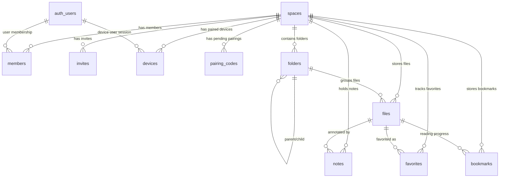
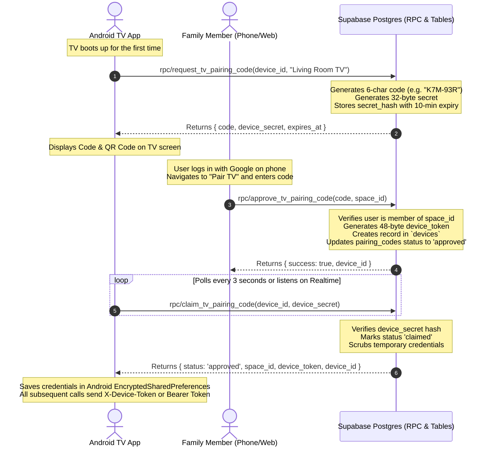

# Supabase Backend Architecture: Family File Library

## 1. Executive Summary

This architecture delivers a production-grade, secure, and completely free-tier-optimized Supabase backend for the **Family File Library** (Android TV, Web Uploader, and Mobile App).

### Key Architectural Highlights
- **Strict Multi-Tenant Space Isolation:** Every family represents an isolated `space`. Row Level Security (RLS) is applied to all 10 tables and Storage objects, mathematically preventing cross-family access.
- **TV Device Authentication Without Admin Credentials:** Android TV devices pair using a secure 6-character ephemeral handshake code approved by an authenticated family member. The TV operates under a dedicated device session or scoped token, allowing read access, annotations, favorites, bookmarks, and soft-delete to Trash, while strictly denying hard deletes, uploads, or administrative privileges.
- **Two-Tier Storage & Bandwidth Optimization:** Private Supabase Storage bucket (`family-files`) enforced with 50 MB file limits and MIME type whitelisting. Files are read via short-lived signed URLs and cached permanently on the TV's local storage to stay well beneath Supabase's 5 GB monthly bandwidth limit.
- **Live Realtime Event Streaming:** Logical replication configured on `files`, `folders`, `notes`, and `pairing_codes` enabling the Android TV app to display instantaneous "New file arrived" notifications without costly background polling or Firebase Cloud Messaging.
- **Automated Free-Tier Keep-Alive & Trash Maintenance:** A scheduled GitHub Action triggers a lightweight database RPC every 3 days, resetting Supabase's 7-day inactivity pause counter and automatically purging trash older than 30 days.

---

## 2. PostgreSQL Schema & Data Dictionary

### Entity-Relationship Diagram



### 2.1 Table Specifications

#### 1. `spaces`
Represents the family library container.
| Column | Type | Constraints | Description |
|---|---|---|---|
| `id` | `uuid` | `PRIMARY KEY, DEFAULT gen_random_uuid()` | Unique space identifier |
| `name` | `text` | `NOT NULL, CHECK (1..100 chars)` | Family name (e.g. "The Smith Family") |
| `created_by` | `uuid` | `REFERENCES auth.users(id) ON DELETE SET NULL` | Creator user ID |
| `pin_hash` | `text` | `NULLABLE` | Salted hash of TV lock PIN (managed via Web) |
| `pin_updated_at` | `timestamptz` | `NULLABLE` | Timestamp of PIN change |
| `created_at` | `timestamptz` | `NOT NULL, DEFAULT now()` | Space creation timestamp |
| `updated_at` | `timestamptz` | `NOT NULL, DEFAULT now()` | Last update timestamp |

#### 2. `members`
Links authenticated Google users (`auth.users`) to spaces with roles.
| Column | Type | Constraints | Description |
|---|---|---|---|
| `id` | `uuid` | `PRIMARY KEY, DEFAULT gen_random_uuid()` | Unique record ID |
| `space_id` | `uuid` | `NOT NULL, REFERENCES spaces(id) ON DELETE CASCADE` | Space foreign key |
| `user_id` | `uuid` | `NOT NULL, REFERENCES auth.users(id) ON DELETE CASCADE` | User foreign key |
| `role` | `text` | `NOT NULL, DEFAULT 'member', CHECK in ('owner', 'admin', 'member')` | Authorization role |
| `display_name` | `text` | `NULLABLE` | Member display name |
| `created_at` | `timestamptz` | `NOT NULL, DEFAULT now()` | Join date |
| `updated_at` | `timestamptz` | `NOT NULL, DEFAULT now()` | Update timestamp |
| **Unique** | `(space_id, user_id)` | Constraint `uq_members_space_user` | One membership per user per space |

#### 3. `invites`
Tracks pending email invitations to join a space.
| Column | Type | Constraints | Description |
|---|---|---|---|
| `id` | `uuid` | `PRIMARY KEY, DEFAULT gen_random_uuid()` | Unique record ID |
| `space_id` | `uuid` | `NOT NULL, REFERENCES spaces(id) ON DELETE CASCADE` | Space foreign key |
| `email` | `text` | `NOT NULL, CHECK valid email format` | Invited Gmail address |
| `invited_by` | `uuid` | `NOT NULL, REFERENCES auth.users(id) ON DELETE CASCADE` | Inviting member |
| `role` | `text` | `NOT NULL, DEFAULT 'member', CHECK in ('admin', 'member')` | Granted role |
| `status` | `text` | `NOT NULL, DEFAULT 'pending', CHECK in ('pending', 'accepted', 'rejected', 'expired')` | State |
| `token` | `text` | `NOT NULL, UNIQUE, DEFAULT encode(gen_random_bytes(24), 'hex')` | Secure invite token |
| `expires_at` | `timestamptz` | `NOT NULL, DEFAULT now() + interval '7 days'` | Expiry deadline |
| `created_at` | `timestamptz` | `NOT NULL, DEFAULT now()` | Creation timestamp |
| `updated_at` | `timestamptz` | `NOT NULL, DEFAULT now()` | Update timestamp |

#### 4. `devices`
Tracks registered and paired TV devices for a space.
| Column | Type | Constraints | Description |
|---|---|---|---|
| `id` | `uuid` | `PRIMARY KEY, DEFAULT gen_random_uuid()` | Device unique ID |
| `space_id` | `uuid` | `NOT NULL, REFERENCES spaces(id) ON DELETE CASCADE` | Space foreign key |
| `device_identifier` | `text` | `NOT NULL` | Hardware installation UUID |
| `device_name` | `text` | `NOT NULL, CHECK (1..100 chars)` | Friendly name ("Living Room TV") |
| `device_type` | `text` | `NOT NULL, DEFAULT 'android_tv', CHECK in ('android_tv', 'phone', 'tablet', 'web')` | Device form factor |
| `auth_user_id` | `uuid` | `REFERENCES auth.users(id) ON DELETE CASCADE` | Optional dedicated device auth user |
| `device_token_hash` | `text` | `NOT NULL` | SHA-256 hash of device secret/token |
| `last_seen_at` | `timestamptz` | `NULLABLE` | Heartbeat timestamp |
| `paired_by` | `uuid` | `REFERENCES auth.users(id) ON DELETE SET NULL` | Approving member |
| `paired_at` | `timestamptz` | `NOT NULL, DEFAULT now()` | Pairing timestamp |
| `is_revoked` | `boolean` | `NOT NULL, DEFAULT false` | Revocation flag |
| `created_at` | `timestamptz` | `NOT NULL, DEFAULT now()` | Record created |
| `updated_at` | `timestamptz` | `NOT NULL, DEFAULT now()` | Record updated |

#### 5. `pairing_codes`
Ephemeral state table for 6-character TV pairing handshake.
| Column | Type | Constraints | Description |
|---|---|---|---|
| `id` | `uuid` | `PRIMARY KEY, DEFAULT gen_random_uuid()` | Unique record ID |
| `code` | `text` | `NOT NULL, UNIQUE, CHECK ~ '^[A-Z0-9]{6,8}$'` | Alphanumeric pairing code |
| `device_identifier` | `text` | `NOT NULL` | Hardware ID of device |
| `device_name` | `text` | `NOT NULL, DEFAULT 'Android TV'` | Device display name |
| `device_secret_hash` | `text` | `NOT NULL` | SHA-256 hash of device secret |
| `status` | `text` | `NOT NULL, DEFAULT 'pending', CHECK in ('pending', 'approved', 'claimed', 'expired', 'rejected')` | Handshake status |
| `space_id` | `uuid` | `REFERENCES spaces(id) ON DELETE CASCADE` | Populated upon approval |
| `approved_by` | `uuid` | `REFERENCES auth.users(id) ON DELETE SET NULL` | Member who approved code |
| `device_credentials`| `jsonb` | `NULLABLE` | Staged token handed to TV on claim |
| `expires_at` | `timestamptz` | `NOT NULL, DEFAULT now() + interval '10 minutes'` | Handshake deadline |

#### 6. `folders`
Hierarchical folders within a family space.
| Column | Type | Constraints | Description |
|---|---|---|---|
| `id` | `uuid` | `PRIMARY KEY, DEFAULT gen_random_uuid()` | Unique folder ID |
| `space_id` | `uuid` | `NOT NULL, REFERENCES spaces(id) ON DELETE CASCADE` | Space foreign key |
| `parent_id` | `uuid` | `REFERENCES folders(id) ON DELETE CASCADE` | Parent folder (null = root) |
| `name` | `text` | `NOT NULL, CHECK (1..120 chars, no illegal chars)` | Folder name |
| `color` | `text` | `CHECK ~ '^#[0-9A-Fa-f]{6}$'` | Hex color code |
| `icon` | `text` | `NULLABLE` | Material icon identifier |
| `created_by` | `uuid` | `REFERENCES auth.users(id) ON DELETE SET NULL` | Creator user |
| `deleted_at` | `timestamptz` | `NULLABLE` | Soft delete timestamp (Trash) |
| `created_at` | `timestamptz` | `NOT NULL, DEFAULT now()` | Creation timestamp |
| `updated_at` | `timestamptz` | `NOT NULL, DEFAULT now()` | Update timestamp |

#### 7. `files`
Metadata, conversion status, extracted text for TTS, and trash state.
| Column | Type | Constraints | Description |
|---|---|---|---|
| `id` | `uuid` | `PRIMARY KEY, DEFAULT gen_random_uuid()` | Unique file ID |
| `space_id` | `uuid` | `NOT NULL, REFERENCES spaces(id) ON DELETE CASCADE` | Space foreign key |
| `folder_id` | `uuid` | `REFERENCES folders(id) ON DELETE SET NULL` | Folder foreign key (null = Inbox) |
| `name` | `text` | `NOT NULL, CHECK (1..255 chars)` | Original file name |
| `file_type` | `text` | `NOT NULL` | MIME type (e.g. `application/pdf`) |
| `file_category`| `text` | `NOT NULL, CHECK in ('pdf', 'image', 'office', 'text', 'other')` | Categorization for TV UI |
| `size_bytes` | `bigint` | `NOT NULL, CHECK (1..52428800)` | File size in bytes (max 50 MB) |
| `storage_path` | `text` | `NOT NULL, UNIQUE` | Bucket object path |
| `pdf_path` | `text` | `NULLABLE` | Converted PDF path for Office docs |
| `text_content` | `text` | `NULLABLE` | Extracted text for TTS & search |
| `conversion_status`| `text` | `NOT NULL, DEFAULT 'ready', CHECK in ('pending', 'processing', 'ready', 'failed', 'not_applicable')` | Office conversion state |
| `conversion_error` | `text` | `NULLABLE` | Failure log if conversion failed |
| `uploader_id` | `uuid` | `REFERENCES auth.users(id) ON DELETE SET NULL` | Uploading member |
| `uploader_name` | `text` | `NOT NULL, DEFAULT 'Family Member'` | Cached name for fast TV display |
| `view_count` | `integer`| `NOT NULL, DEFAULT 0, CHECK (>= 0)` | TV view counter |
| `last_viewed_at`| `timestamptz`| `NULLABLE` | Timestamp of last TV opening |
| `deleted_at` | `timestamptz`| `NULLABLE` | Trash timestamp (null = active) |
| `deleted_by` | `uuid` | `REFERENCES auth.users(id) ON DELETE SET NULL` | User/device who trashed |
| `fts` | `tsvector` | `GENERATED ALWAYS AS (to_tsvector(...)) STORED` | Full text search index |
| `created_at` | `timestamptz`| `NOT NULL, DEFAULT now()` | Upload timestamp |
| `updated_at` | `timestamptz`| `NOT NULL, DEFAULT now()` | Last update timestamp |

#### 8. `notes`
Annotations and notes attached to files or folders.
| Column | Type | Constraints | Description |
|---|---|---|---|
| `id` | `uuid` | `PRIMARY KEY, DEFAULT gen_random_uuid()` | Unique note ID |
| `space_id` | `uuid` | `NOT NULL, REFERENCES spaces(id) ON DELETE CASCADE` | Space foreign key |
| `file_id` | `uuid` | `REFERENCES files(id) ON DELETE CASCADE` | Target file ID |
| `folder_id` | `uuid` | `REFERENCES folders(id) ON DELETE CASCADE` | Target folder ID |
| `author_id` | `uuid` | `REFERENCES auth.users(id) ON DELETE SET NULL` | Member author |
| `author_device_id`| `uuid` | `REFERENCES devices(id) ON DELETE SET NULL` | TV device author |
| `author_name` | `text` | `NOT NULL, DEFAULT 'Family Member'` | Display author name |
| `content` | `text` | `NOT NULL, CHECK (length > 0)` | Note markdown or text body |
| `page_number` | `integer` | `CHECK (page_number >= 1)` | PDF page number annotation |
| `deleted_at` | `timestamptz` | `NULLABLE` | Soft delete timestamp |
| `created_at` | `timestamptz` | `NOT NULL, DEFAULT now()` | Creation timestamp |
| `updated_at` | `timestamptz` | `NOT NULL, DEFAULT now()` | Update timestamp |

#### 9. `favorites`
Quick-access starred items for the TV Home screen shelf.
| Column | Type | Constraints | Description |
|---|---|---|---|
| `id` | `uuid` | `PRIMARY KEY, DEFAULT gen_random_uuid()` | Unique record ID |
| `space_id` | `uuid` | `NOT NULL, REFERENCES spaces(id) ON DELETE CASCADE` | Space foreign key |
| `file_id` | `uuid` | `NOT NULL, REFERENCES files(id) ON DELETE CASCADE` | Favorited file |
| `user_id` | `uuid` | `REFERENCES auth.users(id) ON DELETE CASCADE` | User actor |
| `device_id` | `uuid` | `REFERENCES devices(id) ON DELETE CASCADE` | TV device actor |
| `created_at` | `timestamptz` | `NOT NULL, DEFAULT now()` | Star timestamp |

#### 10. `bookmarks`
Document reading progress and page markers.
| Column | Type | Constraints | Description |
|---|---|---|---|
| `id` | `uuid` | `PRIMARY KEY, DEFAULT gen_random_uuid()` | Unique bookmark ID |
| `space_id` | `uuid` | `NOT NULL, REFERENCES spaces(id) ON DELETE CASCADE` | Space foreign key |
| `file_id` | `uuid` | `NOT NULL, REFERENCES files(id) ON DELETE CASCADE` | Document file ID |
| `user_id` | `uuid` | `REFERENCES auth.users(id) ON DELETE CASCADE` | User actor |
| `device_id` | `uuid` | `REFERENCES devices(id) ON DELETE CASCADE` | TV device actor |
| `page_number`| `integer` | `NOT NULL, CHECK (page_number >= 1)` | Page index (1-based) |
| `scroll_position` | `numeric(6,4)` | `NOT NULL, DEFAULT 0.0000, CHECK (0.0..1.0)` | Vertical scroll offset |
| `label` | `text` | `NULLABLE` | User-defined note or label |
| `is_last_read` | `boolean` | `NOT NULL, DEFAULT false` | Drives "Continue Reading" shelf |
| `created_at` | `timestamptz` | `NOT NULL, DEFAULT now()` | Bookmark creation date |
| `updated_at` | `timestamptz` | `NOT NULL, DEFAULT now()` | Last reading update |

---

## 3. Row Level Security (RLS) & Access Control

### 3.1 Security Definer Functions
To avoid recursive policy evaluation and query performance issues, all RLS rules call high-speed `SECURITY DEFINER` helper functions with pinned `search_path = public`:

1. `public.has_space_access(p_space_id uuid) -> boolean`:
   Returns `true` if `auth.uid()` belongs to `members` OR matches `devices.auth_user_id` (or `X-Device-Token` header matches active `devices.device_token_hash`).
2. `public.is_space_member_user(p_space_id uuid) -> boolean`:
   Returns `true` only for authenticated human members (excludes TV devices). Used to restrict file uploads and space administration.
3. `public.is_space_admin(p_space_id uuid) -> boolean`:
   Returns `true` if caller is a member with role `owner` or `admin`.
4. `public.get_auth_device_id() -> uuid`:
   Resolves the calling TV device's primary key ID.

### 3.2 Policy Matrix Across All Tables

| Table | SELECT | INSERT | UPDATE | DELETE |
|---|---|---|---|---|
| `spaces` | `has_space_access(id)` | Authenticated users | `is_space_admin(id)` | Owner only |
| `members` | `has_space_access(space_id)` | Space Admin / Self (create) | Space Admin or Self | Space Admin or Self |
| `invites` | `has_space_access(space_id)` or email match | `is_space_admin(space_id)` | Admin or Invitee | `is_space_admin(space_id)` |
| `devices` | `has_space_access(space_id)` | `is_space_admin(space_id)` (or pairing RPC) | `has_space_access(space_id)` | `is_space_admin(space_id)` |
| `pairing_codes` | Pending caller or member | Handled via RPC | Handled via RPC | Admin or RPC cleanup |
| `folders` | `has_space_access(space_id)` | `is_space_member_user(space_id)` | `has_space_access(space_id)` (edit / trash) | `is_space_admin(space_id)` |
| `files` | `has_space_access(space_id)` | `is_space_member_user(space_id)` | `has_space_access(space_id)` (trash / view count) | Admin or Uploader |
| `notes` | `has_space_access(space_id)` | `has_space_access(space_id)` | Author or Admin | Author or Admin |
| `favorites` | `has_space_access(space_id)` | `has_space_access(space_id)` | N/A | Creator or Admin |
| `bookmarks` | `has_space_access(space_id)` | `has_space_access(space_id)` | `has_space_access(space_id)` | Creator or Admin |

---

## 4. TV Device Pairing & Authentication Protocol

The TV app never stores or requests admin/service-role credentials. It authenticates through a 3-step cryptographically verified handshake.

### Pairing Sequence Diagram



### Security Properties of the TV Pairing Protocol:
1. **Zero Admin Leakage:** The TV receives only its scoped `device_token`. It cannot read other spaces or modify space configuration.
2. **Ephemeral Codes:** Pairing codes expire in 10 minutes and use an alphanumeric alphabet (`ABCDEFGHJKLMNPQRSTUVWXYZ23456789`) that avoids ambiguous characters (`0/O`, `1/I`).
3. **Secret Verification:** Only the device holding the original unhashed `device_secret` can claim the approved credentials, preventing race condition intercept attacks.
4. **Instant Revocation:** A family member can revoke the TV from the Web app at any time by toggling `devices.is_revoked = true`, instantly invalidating all TV access.

---

## 5. Trash Lifecycle & 30-Day Purge Architecture

To protect family files against accidental deletions, all deletions on the TV and Web default to soft-deletions:

1. **Move to Trash (Soft Delete):**
   ```sql
   UPDATE public.files
   SET deleted_at = now(), deleted_by = auth.uid()
   WHERE id = :file_id AND public.has_space_access(space_id);
   ```
2. **Active Queries (Standard TV & Web Views):**
   The database provides `public.view_active_files` which automatically applies `WHERE deleted_at IS NULL`.
3. **Restore from Trash:**
   ```sql
   UPDATE public.files
   SET deleted_at = NULL, deleted_by = NULL
   WHERE id = :file_id AND public.has_space_access(space_id);
   ```
4. **Automated 30-Day Purge:**
   The function `public.cleanup_expired_trash()` permanently deletes files and folders where `deleted_at < now() - interval '30 days'`. It runs automatically every 3 days via the keep-alive ping.

---

## 6. Supabase Storage Configuration

### Bucket Details
- **Bucket ID:** `family-files`
- **Privacy:** `public: false` (strictly private; objects are accessible only via authenticated RLS or signed URLs).
- **File Size Limit:** `52,428,800` bytes (50 MB), matching the maximum allowed file size on Supabase free tier.
- **Allowed MIME Types:** PDF, JPEG, PNG, WebP, GIF, HEIC, Word (.doc/.docx), Excel (.xls/.xlsx), PowerPoint (.ppt/.pptx), Plain Text, Markdown, and CSV.

### Storage Path Conventions
- **Original Uploads:** `<space_id>/original/<file_id>/<sanitized_filename>`
- **Converted Office PDFs:** `<space_id>/converted/<file_id>.pdf`
- **Thumbnails:** `<space_id>/thumbnails/<file_id>.webp`

### Storage RLS Policies
Storage policies dynamically extract the `<space_id>` from the first segment of the storage object path using `public.extract_space_id_from_path(name)`:
- **Read:** Permitted if `public.has_space_access(space_id) = true`.
- **Upload:** Permitted only if caller is an authenticated human family member (`public.is_space_member_user(space_id) = true`).
- **Delete:** Restricted to space admins or the original uploader.

### Bandwidth Protection Strategy (Under 5 GB / Month)
Supabase free tier provides 5 GB of monthly bandwidth. Serving large documents and high-resolution images repeatedly will exhaust this quota.
- **Solution:** The TV app downloads files via a 60-minute signed URL and caches them in internal app storage (`context.cacheDir` or `context.filesDir/cached_files`).
- Subsequent views open directly from local cache with zero network roundtrips.
- Office documents are converted once by GitHub Actions and saved as compact PDFs, saving bandwidth.

---

## 7. Realtime Notification Configuration

To trigger the **"New file arrived"** popup on Android TV without battery-draining polling or Google FCM:

### 1. Database Configuration
Logical replication is activated on key tables with `replica identity full`:
```sql
alter table public.files replica identity full;
alter publication supabase_realtime add table public.files;
```

### 2. Android TV Client Listener (Kotlin Compose)
Using `supabase-kt` on Android TV:

```kotlin
class RealtimeFileMonitor(
    private val supabase: SupabaseClient,
    private val spaceId: String,
    private val onNewFileArrived: (fileName: String, uploader: String) -> Unit
) {
    private var channel: RealtimeChannel? = null

    suspend fun startListening(coroutineScope: CoroutineScope) {
        channel = supabase.realtime.channel("space-feed-$spaceId") {
            // Optional: configure broadcast or presence if needed
        }

        val changeFlow = channel!!.postgresChangeFlow<PostgresAction>(schema = "public") {
            table = "files"
            filter = "space_id=eq.$spaceId"
        }

        changeFlow.onEach { action ->
            when (action) {
                is PostgresAction.Insert -> {
                    val newFile = action.decodeRecord<FileDto>()
                    // Only notify if file is not trashed and conversion is ready or not needed
                    if (newFile.deletedAt == null) {
                        onNewFileArrived(newFile.name, newFile.uploaderName)
                    }
                }
                is PostgresAction.Update -> {
                    val updatedFile = action.decodeRecord<FileDto>()
                    // Handle conversion status change or trash update
                }
                is PostgresAction.Delete -> {
                    // Handle permanent deletion
                }
            }
        }.launchIn(coroutineScope)

        supabase.realtime.connect()
    }

    suspend fun stopListening() {
        channel?.leave()
        supabase.realtime.disconnect()
    }
}
```

---

## 8. Free-Tier Keep-Alive & Project Pause Prevention

Supabase automatically pauses free projects after **7 consecutive days of inactivity**.

### Solution: Scheduled GitHub Action Workflow
File: `.github/workflows/supabase-keepalive.yml`
- **Schedule:** `cron: '0 4 */3 * *'` (Runs every 3 days at 04:00 UTC).
- **Execution:** Calls `POST https://<project-ref>.supabase.co/rest/v1/rpc/health_check_ping`.
- **Payload & Auth:** Authenticates using `SUPABASE_ANON_KEY`.
- **Side Effect:** Executes a real database read query on `spaces`, completely resetting the 7-day pause timer, and triggers `cleanup_expired_trash()` to permanently purge items that have been in the trash for more than 30 days.

---

## 9. Deployment & Verification Guide

### Step 1: Run the Migration in Supabase
Using Supabase CLI:
```bash
supabase db push
# Or apply directly via SQL Editor in the Supabase Dashboard:
# Copy and run supabase/migrations/20261111000000_family_file_library_init.sql
```

### Step 2: Configure Supabase Auth (Google OAuth)
1. Go to **Authentication -> Providers -> Google**.
2. Enable Google Provider and enter Client ID and Client Secret from Google Cloud Console.
3. Ensure basic scopes are requested (`email`, `profile`).

### Step 3: Add GitHub Secrets for Keep-Alive
In your private GitHub repository, navigate to **Settings -> Secrets and variables -> Actions** and add:
- `SUPABASE_URL`: `https://<your-project-id>.supabase.co`
- `SUPABASE_ANON_KEY`: `<your-supabase-anon-public-key>`

### Step 4: Verification Queries
Run this test script in the Supabase SQL Editor to confirm security boundaries:

```sql
-- 1. Create two test spaces
insert into public.spaces (id, name) values 
  ('11111111-1111-1111-1111-111111111111', 'Family A'),
  ('22222222-2222-2222-2222-222222222222', 'Family B');

-- 2. Verify health check ping RPC
select public.health_check_ping();

-- 3. Request TV pairing code
select public.request_tv_pairing_code('test-hardware-uuid-1234', 'Living Room TV');
```
